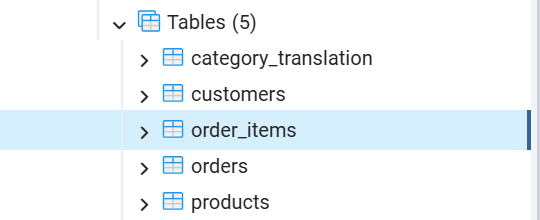
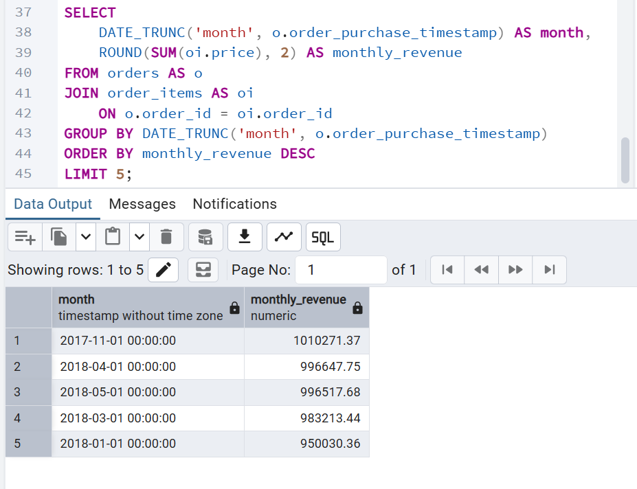
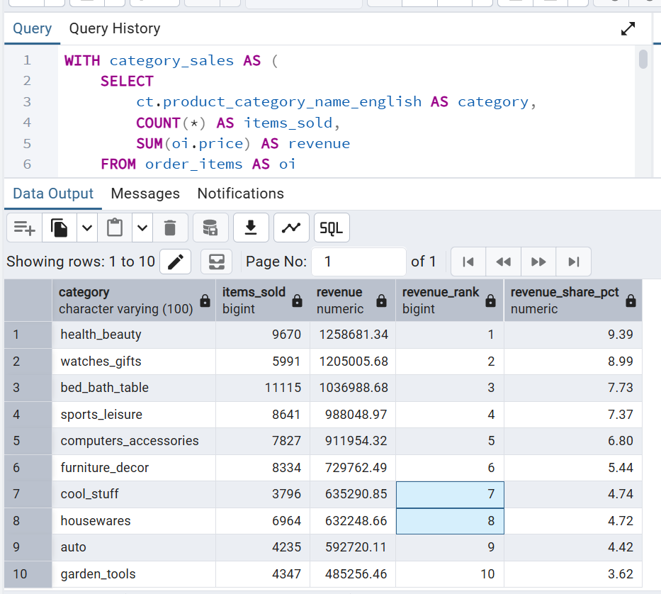
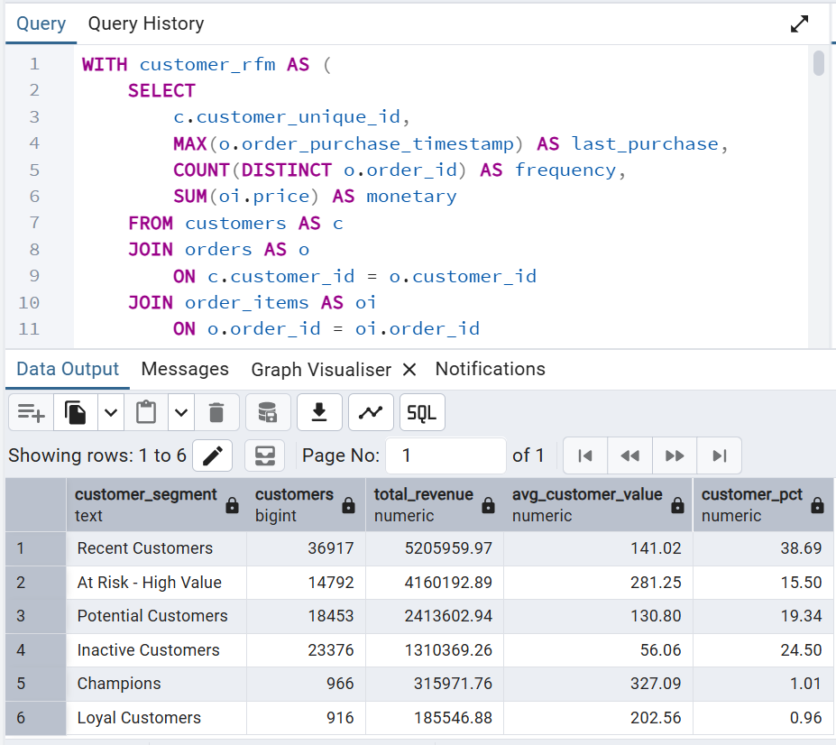

# Retail Sales & Customer Analytics

## Project Overview

This project analyzes approximately 100,000 e-commerce orders from the Brazilian marketplace Olist using PostgreSQL.

The objective was to build a relational database from raw CSV files and use SQL to investigate sales performance, product-category performance, customer purchasing behavior, and customer value.

The project progresses from database design and data validation to multi-table analysis, window functions, and RFM-style customer segmentation.

---

## Business Questions

The analysis focused on the following questions:

1. How much product-sales revenue was generated?
2. What was the average order value?
3. How did revenue change over time?
4. Which product categories generated the most revenue?
5. How concentrated was revenue across product categories?
6. What proportion of customers made repeat purchases?
7. Who were the highest-value customers?
8. How can customers be segmented using recency, frequency, and monetary value?

---

## Dataset

**Source:** Brazilian E-Commerce Public Dataset by Olist

The dataset contains anonymized information about approximately 100,000 orders placed between 2016 and 2018.

Core tables used in this analysis:

- `customers`
- `orders`
- `order_items`
- `products`
- `category_translation`

The relational structure used for the analysis was:

`customers → orders → order_items → products`

Product category names were translated using the category translation table.

---

## Database Structure

The raw CSV files were imported into PostgreSQL and relationships were established using primary and foreign keys.



Key relationships include:

- `customers.customer_id → orders.customer_id`
- `orders.order_id → order_items.order_id`
- `products.product_id → order_items.product_id`

---

## Tools & SQL Skills

**Database:** PostgreSQL  
**Database Management:** pgAdmin 4

SQL techniques demonstrated:

- Relational database design
- Primary and foreign keys
- `SELECT`, `WHERE`, `GROUP BY`, `ORDER BY`
- Aggregate functions
- Multi-table `JOIN`s
- Subqueries
- Common Table Expressions (CTEs)
- `CASE WHEN`
- Date functions
- Window functions
- `RANK()`
- `NTILE()`
- Percentage-of-total calculations
- RFM-style customer segmentation

---

## Sales Analysis

Total product-sales revenue in the dataset was:

**13,591,643.70**

Average order value was:

**137.75**

Monthly sales analysis covered September 2016 through September 2018.

November 2017 recorded the highest product-sales revenue at approximately:

**1,010,271.37**



The first and final months represent partial periods and should therefore be interpreted cautiously when comparing monthly performance.

---

## Product Category Analysis

Product categories were analyzed by number of items sold, order count, total product-sales revenue, average item price, revenue ranking, and share of categorized revenue.

The highest-revenue categories included:

| Category | Revenue | Revenue Share |
|---|---:|---:|
| Health & Beauty | 1,258,681.34 | 9.39% |
| Watches & Gifts | 1,205,005.68 | 8.99% |
| Bed, Bath & Table | 1,036,988.68 | 7.73% |
| Sports & Leisure | 988,048.97 | 7.37% |
| Computers & Accessories | 911,954.32 | 6.80% |



### Finding

Health & Beauty generated the highest category revenue.

However, Bed, Bath & Table sold more items than Health & Beauty and Watches & Gifts. Watches & Gifts generated comparatively high revenue with fewer items because its average item price was substantially higher.

Revenue was also distributed across several categories rather than being dominated by a single category.

---

## Customer Behavior

Customer analysis used `customer_unique_id` to identify customers across orders.

The analysis found:

- **93,099 one-time customers**
- **2,997 repeat customers**
- **96.88% one-time customers**
- **3.12% repeat customers**

This indicates low observed repeat-purchase behavior during the available dataset period.

Because the dataset covers a finite historical period, this should not be interpreted as a complete measure of long-term customer retention.

---

## RFM Customer Segmentation

Customers were analyzed using three dimensions:

**Recency** — days since the customer's most recent purchase relative to the final transaction date in the dataset.

**Frequency** — number of distinct orders placed by the customer.

**Monetary Value** — total product-sales value associated with the customer.

Because the overwhelming majority of customers placed only one order, frequency was not divided mechanically into quintiles. Instead, frequency scores were assigned according to actual purchase counts to avoid misleading scores among tied customers.

Customers were then grouped into analyst-defined segments.

| Segment | Customers | Product Sales | Avg. Customer Value | Customer Share |
|---|---:|---:|---:|---:|
| Recent Customers | 36,917 | 5,205,959.97 | 141.02 | 38.69% |
| At Risk - High Value | 14,792 | 4,160,192.89 | 281.25 | 15.50% |
| Potential Customers | 18,453 | 2,413,602.94 | 130.80 | 19.34% |
| Inactive Customers | 23,376 | 1,310,369.26 | 56.06 | 24.50% |
| Champions | 966 | 315,971.76 | 327.09 | 1.01% |
| Loyal Customers | 916 | 185,546.88 | 202.56 | 0.96% |



### Finding

The **At Risk - High Value** segment represented only 15.50% of customers but accounted for approximately 4.16 million in historical product sales.

The **Champions** segment represented just 1.01% of customers but recorded the highest average customer value at 327.09.

Inactive customers represented 24.50% of customers but had substantially lower average customer value.

---

## Business Recommendations

Based on the analysis:

1. **Prioritize high-value customer reactivation.**  
   Customers classified as At Risk - High Value have substantial historical value and may warrant targeted re-engagement efforts.

2. **Develop repeat-purchase strategies.**  
   Only 3.12% of observed customers made repeat purchases during the dataset period, suggesting an opportunity to investigate retention and second-purchase conversion.

3. **Protect high-value customer relationships.**  
   Champions represent a small customer group but have the highest average customer value.

4. **Consider both volume and pricing in category strategy.**  
   High category revenue can result from high sales volume, higher average item prices, or a combination of both.

---

## Project Structure

```text
Retail-SQL-Analytics/
│
├── README.md
│
├── sql/
│   ├── 01_database_setup.sql
│   ├── 02_sales_analysis.sql
│   ├── 03_product_analysis.sql
│   └── 04_customer_segmentation.sql
│
└── screenshots/
    ├── 01_database_tables.png
    ├── 02_monthly_revenue.png
    ├── 03_category_analysis.png
    └── 04_customer_segments.png
    └── 04_customer_segments.png
```

## Author

**Ian Mark Esipisu**

Data Analytics | SQL | PostgreSQL | Research | Financial Engineering